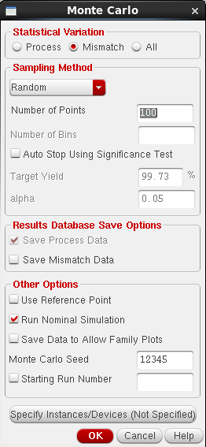
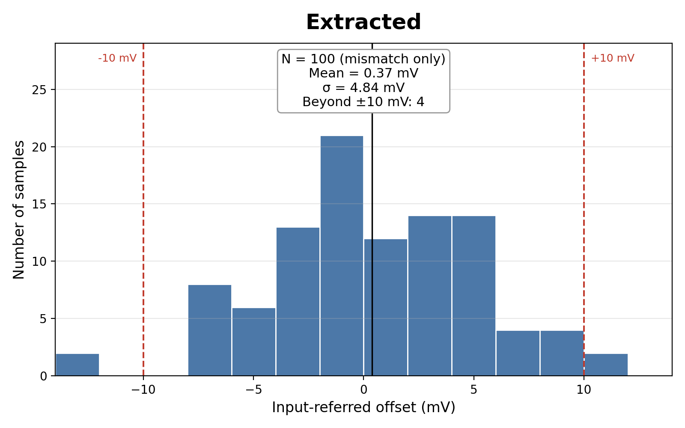

# Monte Carlo Mismatch Analysis

## Why

The nominal simulation uses perfectly identical transistors, so it only shows the systematic offset (0.737 mV), which comes from the design itself. Real transistors never match exactly: threshold voltage and current factor vary randomly from device to device. That random mismatch adds a random input offset that is different on every chip. Monte Carlo analysis estimates its spread by simulating the circuit many times, each time with new random device parameters drawn from the gpdk090 mismatch models.

Pelgrom's law sets the expected size of this spread:

```
σ(ΔV_T) = A_VT / √(W·L)
```

The input pair is 3 µm × 360 nm (W·L ≈ 1.08 µm²). With the mismatch coefficients in the gpdk090 model file (about 3 to 4 mV·µm), the expected input offset is a few millivolts. That is much larger than the systematic offset.

## Setup

| Setting | Value |
|---|---|
| Tool | Cadence ADE XL, Spectre |
| Statistical variation | Mismatch only (no global process variation) |
| Sampling | Random |
| Number of points | 100 per run |
| Seed | 12345 |
| Measurement | DC sweep of VINP from 0.66 V to 0.74 V in 100 µV steps |
| Trip point | VINP at which OUT crosses VDD/2 = 0.5 V |
| Offset | Trip point − 700 mV |
| Conditions | VDD = 1 V, 27 °C, VREF = 700 mV, IBIAS = 20 µA |



Two runs were made:

- **Schematic** (`MonteCarlo.2`)
- **Extracted layout** (`MonteCarlo.4`), with `av_extracted` placed first in the switch view list so that the RC-extracted netlist replaces the schematic of the core cell

### Runs that were discarded

| Run | Reason |
|---|---|
| `MonteCarlo.0` | 10-point trial run |
| `MonteCarlo.1` | Sweep of only 0.69 V to 0.71 V; samples with a large offset had their trip point outside the sweep, giving 12 simulation errors. The sweep was widened to 0.66 V to 0.74 V. |
| `MonteCarlo.3` | Labelled "extracted", but its results were identical to the schematic run, so the extracted view was not actually being simulated. Fixed in `MonteCarlo.4` by putting `av_extracted` first in the switch view list. |

## Results

| Quantity | Schematic | Extracted |
|---|---|---|
| Simulation errors | 0 | 0 |
| Mean offset | 0.44 mV | 0.37 mV |
| Median offset | 0.81 mV | −0.06 mV |
| Standard deviation σ | **5.40 mV** | **4.84 mV** |
| Minimum / maximum | −11.41 / +11.93 mV | −13.24 / +11.85 mV |
| 3σ | 16.2 mV | 14.5 mV |
| Samples with \|offset\| > 10 mV | 6 of 100 | 4 of 100 |
| Samples within ±10 mV | 94% | 96% |




## Interpretation

1. **Random mismatch dominates.** The standard deviation of about 5 mV is about seven times the 0.74 mV systematic offset. In silicon, the resolution of this comparator is set by mismatch, not by the design's nominal offset.

2. **The schematic and extracted spreads are statistically the same.** With N = 100, a standard deviation is uncertain by about σ/√(2N) ≈ 7%, or about ±0.4 mV. The 0.56 mV difference between 5.40 and 4.84 mV is only about one standard error of the difference, so it is sampling noise. The layout does not reduce mismatch.

3. **The individual samples differ between the two runs** because the extracted view is built from individual finger devices (17 transistors instead of 8). The random draws are therefore different even with the same seed. This also confirms that the extracted view was in use.

4. **No systematic shift.** Both means lie within about ±0.5 mV (σ/√N) of zero.

5. **The tails follow a normal distribution.** A normal distribution with σ = 4.84 mV predicts 3.9% of samples beyond ±10 mV (4 observed). With σ = 5.40 mV it predicts 6.4% (6 observed).

6. **Parasitics do not change DC offset.** Wire capacitance has no effect at DC, and wire resistance carries only microamps, so similar spreads for the schematic and extracted views are the expected result.

## Limits of this analysis

- Only the random device mismatch in the model is covered. Global process corners and layout-dependent effects such as gradients across the die are not included.
- The input pair is placed side by side, not in a common-centroid arrangement, so a real chip could show additional gradient-induced offset.
- 100 samples give a useful estimate of σ but not of the far tails.

## How to reduce the random offset

- Increase the area of the input pair and the mirror load (σ ∝ 1/√(W·L)), at the cost of more capacitance and lower speed.
- Use a common-centroid layout with dummy devices for NM0/NM1 and PM1/PM3.
- Add offset cancellation (auto-zeroing or trimming) if sub-millivolt accuracy is required.
