# Two-Stage CMOS Comparator

Design, layout and post-layout verification of a 1 V two-stage CMOS comparator in Cadence Virtuoso (gpdk090, Spectre, Assura). The work includes DC, transient and AC characterization, temperature corners, an overdrive sweep, DRC/LVS-clean layout, RC parasitic extraction and Monte Carlo mismatch analysis.

Analog CMOS IC Design course project, Nirma University, guided by Prof. Akash Mecwan.

## Circuit

- **Bias:** a 20 µA reference into diode-connected NM5, mirrored 1:1 by NM2 as the tail current source.
- **Stage 1:** NMOS differential pair NM0/NM1 with a PMOS current-mirror load PM1/PM3. VINN is tied to VREF = 700 mV, and the output is node X.
- **Stage 2:** a skewed CMOS inverter (MPinv/MNinv) that restores logic levels and drives CL = 50 fF. OUT is high when VINP > VREF.
- VDD = 1 V. PMOS bodies are tied to VDD and NMOS bodies to GND.

| Device | Function | W / L |
|---|---|---|
| NM0, NM1 | Input differential pair | 3 µm / 360 nm |
| PM1, PM3 | PMOS current-mirror load | 3.2 µm / 360 nm |
| NM5, NM2 | Bias mirror and tail source | 2.5 µm / 360 nm |
| MPinv | Inverter PMOS | 5 µm / 100 nm |
| MNinv | Inverter NMOS | 120 nm / 100 nm |

The 360 nm channel length raises output resistance (gain) and improves matching. The inverter is skewed so that its switching threshold sits close to the balance voltage of node X, which keeps the systematic offset small.

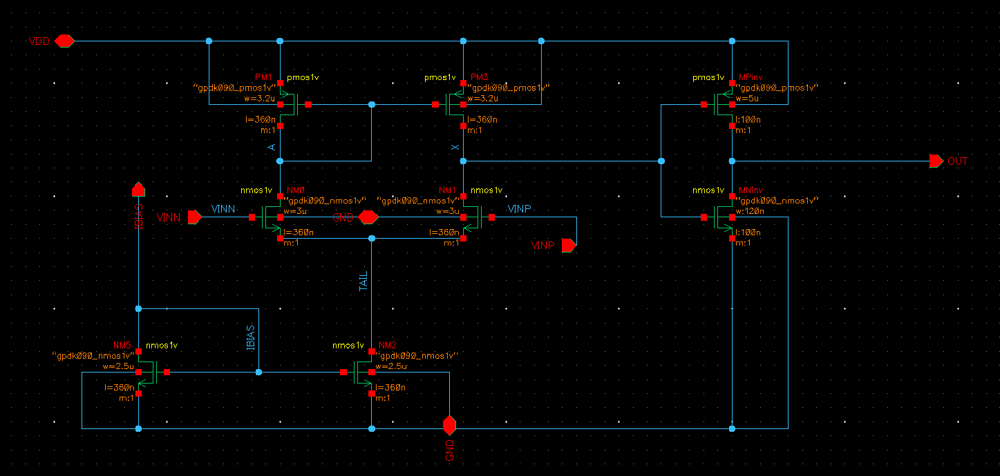
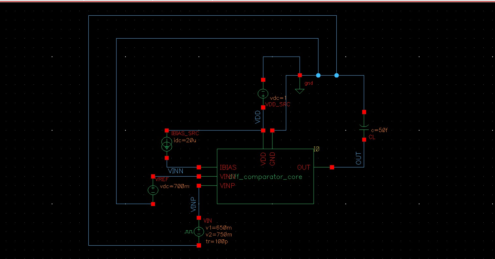

## Results summary (VDD = 1 V, 27 °C)

| Metric | Schematic | Post-layout | Change |
|---|---|---|---|
| Trip point | 700.737 mV | 700.718 mV | −0.019 mV |
| Systematic offset | 0.737 mV | 0.718 mV | −19.3 µV |
| tpLH | 1.028 ns | 1.088 ns | +5.8% |
| tpHL | 1.111 ns | 1.164 ns | +4.8% |
| Average delay | 1.070 ns | 1.126 ns | +5.3% |
| Rise / fall time | 573 ps / 1.021 ns | 598 ps / 1.043 ns | +4.3% / +2.1% |
| Average power | 51.99 µW | 52.10 µW | +0.2% |
| First-stage gain (Case A) | 27.87 dB | 27.86 dB | −0.003 dB |
| X −3 dB bandwidth (Case A) | 31.84 MHz | 30.73 MHz | −3.5% |
| X unity-gain frequency (Case A) | 1.157 GHz | 1.060 GHz | −8.4% |
| OUT gain (Case A) | 45.52 dB | 45.56 dB | +0.04 dB |
| Random offset σ (Monte Carlo, N = 100) | 5.40 mV | 4.84 mV | same within sampling error |

Transient: ±50 mV overdrive (VIN pulse 650 to 750 mV, 100 ps edges). AC: Case A at VIN = 700 mV, Case B at VIN = 700.75 mV (next to the trip point).

## Pre-layout characterization

### DC transfer

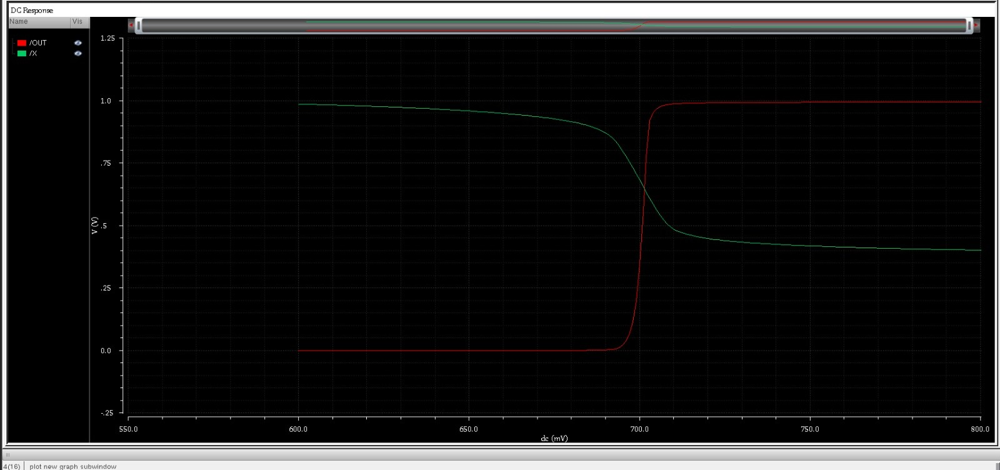
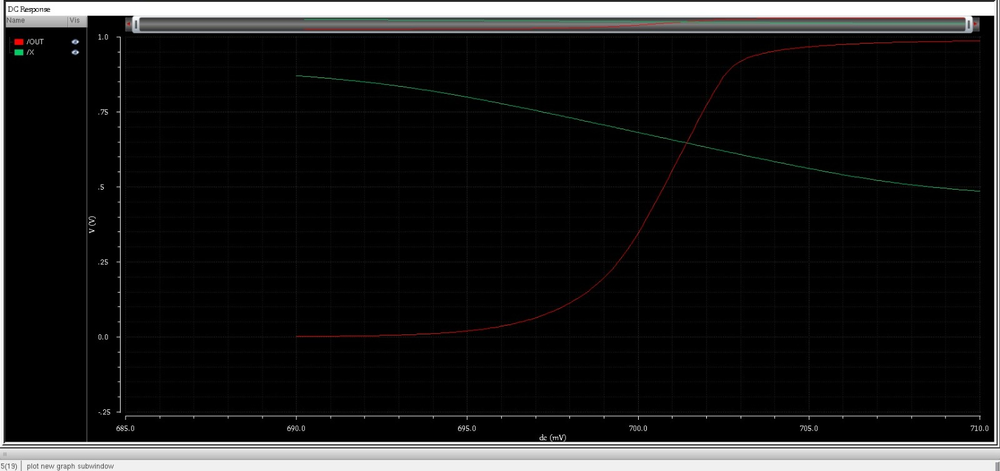

### Transient

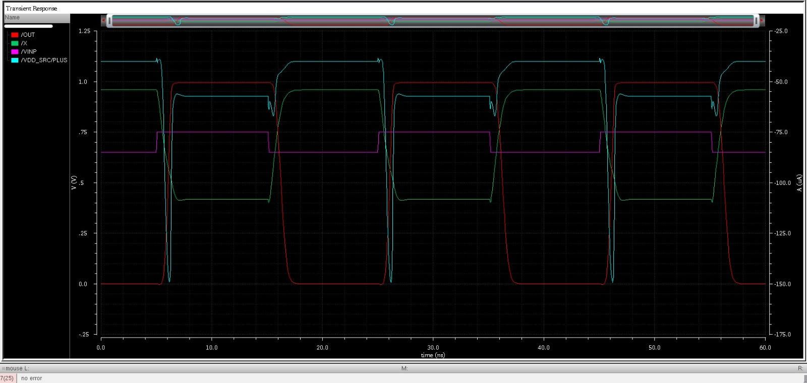

### Overdrive sweep (2 to 100 mV)

The average delay falls from about 4 ns at 2 mV to about 1 ns at 100 mV. At small overdrive the first stage behaves as a linear amplifier; at large overdrive node X slews.

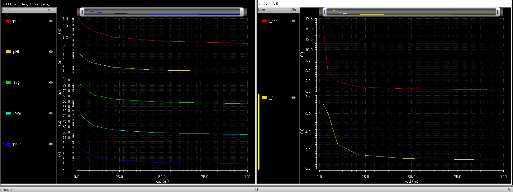

### Temperature (VDD = 1 V, 50 mV overdrive)

| T (°C) | Trip (mV) | Offset (mV) | A1 (V/V) | tpLH (ns) | tpHL (ns) | tp avg (ns) | Power (µW) |
|---|---|---|---|---|---|---|---|
| −40 | 701.547 | 1.547 | 24.41 | 0.914 | 0.899 | 0.906 | 53.46 |
| 27 | 700.737 | 0.737 | 24.73 | 1.028 | 1.111 | 1.070 | 51.99 |
| 125 | 699.616 | −0.384 | 23.95 | 1.148 | 1.470 | 1.309 | 50.16 |

### AC response

| Schematic | Case A | Case B |
|---|---|---|
| First-stage gain | 27.87 dB | 27.86 dB |
| X −3 dB bandwidth | 31.84 MHz | 29.36 MHz |
| X unity-gain frequency | 1.157 GHz | 1.151 GHz |
| OUT gain | 45.52 dB | 46.68 dB |

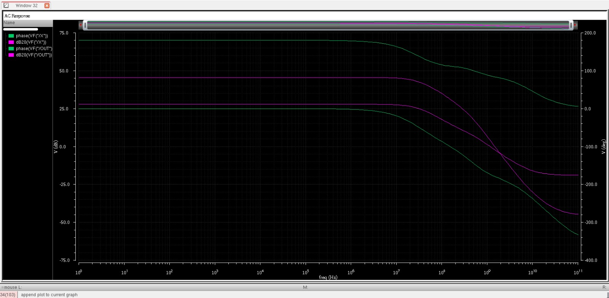

## Layout and physical verification

PMOS devices sit in an n-well at the top, enclosed by an N-tap guard ring tied to VDD. NMOS devices sit at the bottom inside a P-tap guard ring tied to GND. Wide devices are multi-finger, so the extracted netlist contains 17 transistors against 8 in the schematic. Routing uses Metal1 and Metal2.

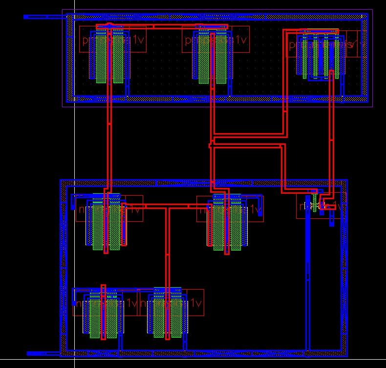

| Check | Result |
|---|---|
| DRC (Assura, gpdk090 rules) | 0 errors |
| LVS (Assura) | Schematic and layout match: 0 net, device, pin or parameter mismatches |
| RCX (Assura) | Extraction type RC: 142 resistors and 74 capacitors besides the 17 finger devices |

The first DRC run flagged n-well connection and spacing, Metal1 width, Metal1/Metal2 spacing and Metal1 minimum-area violations. All were fixed. The first LVS runs failed because of shorts (IBIAS to GND at the bias-mirror drain via, and VINN to node A near NM0). Moving the vias removed them.

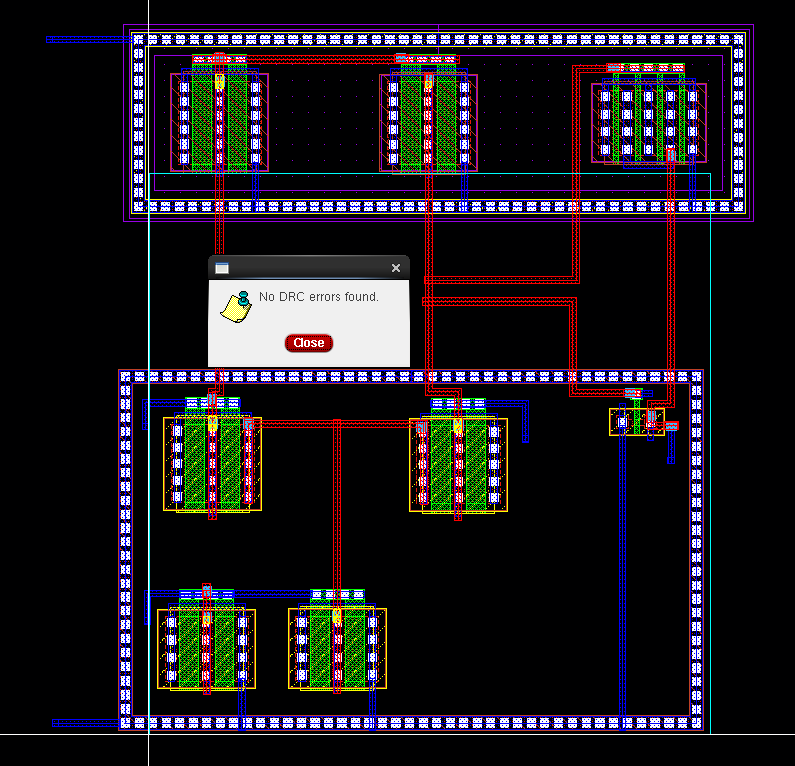
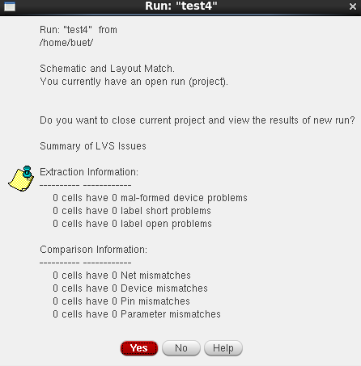
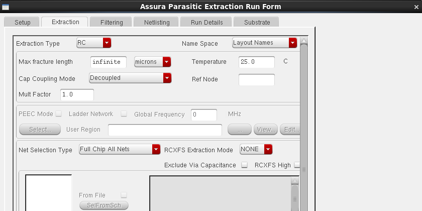
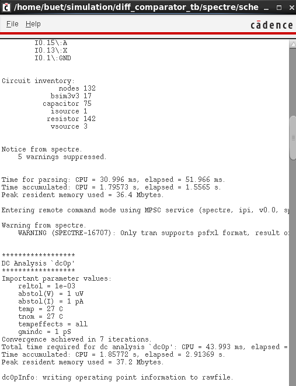

## Post-layout simulation

The same testbench was run with the `av_extracted` view of the core. Delay rises by 5.3% and the first-stage unity-gain frequency falls by 8.4%, both from the added wiring capacitance at node X. DC quantities (trip point, gain, power) stay within 0.5%, because capacitance has no effect at DC.

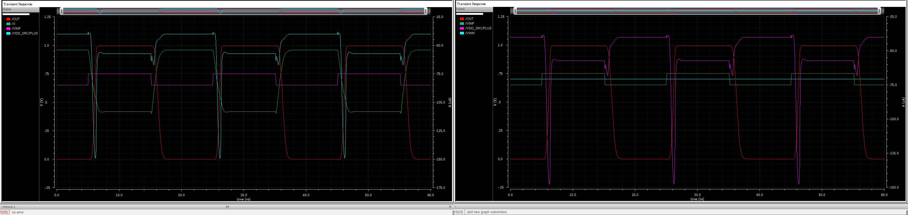
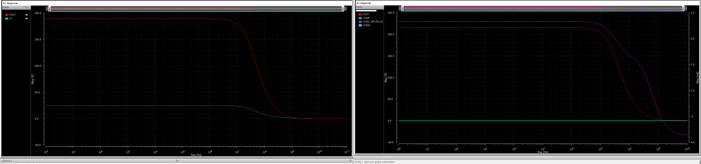

## Monte Carlo mismatch analysis

100-point, mismatch-only Monte Carlo on both the schematic and the extracted view gives an input offset standard deviation of 5.40 mV and 4.84 mV. The two are statistically the same, and both are about seven times the 0.74 mV systematic offset, so random mismatch sets the practical resolution.

Full setup, results and interpretation: [MONTE_CARLO.md](MONTE_CARLO.md)

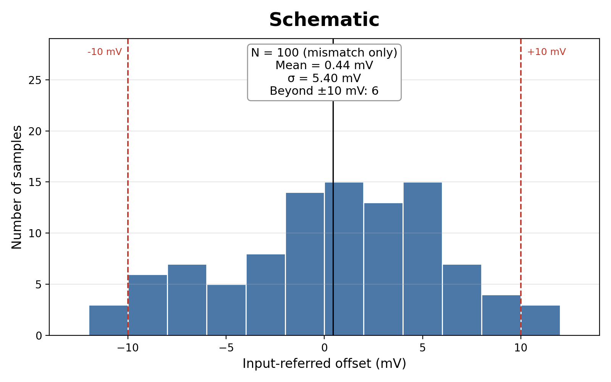

## OCEAN script

[`ocean/comparator_pvt.ocn`](ocean/comparator_pvt.ocn) is an optional OCEAN script that automates DC, transient and AC characterization over temperature/supply corners and an overdrive sweep, writing the results to a CSV. The results reported above were obtained in ADE L and ADE XL.

To use it:
1. Set the VDD source to `vsup`, and VIN to DC `vin`, pulse levels `0.7-vod` / `0.7+vod`, AC magnitude 1.
2. Copy the `design`, `resultsDir` and `modelFile` lines from ADE L > Session > Save Ocean Script into the script header.
3. In the CIW: `load("comparator_pvt.ocn")`

## Tools

Cadence Virtuoso (schematic, Layout XL), ADE L, ADE XL, Spectre, Assura (DRC, LVS, RCX), gpdk090.
