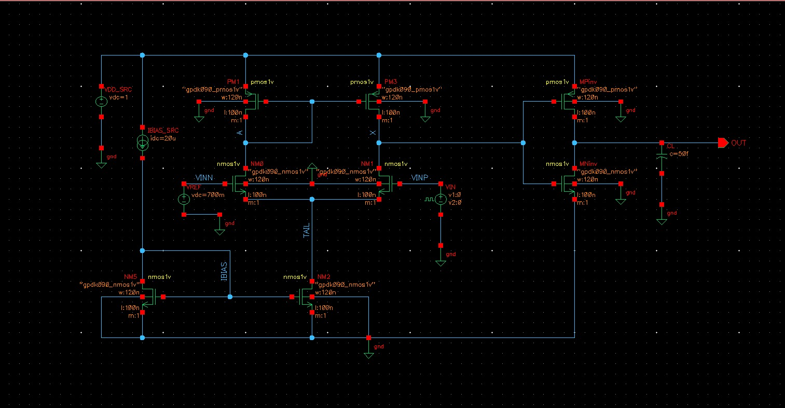

# Two-Stage CMOS Comparator

Schematic, layout and post-layout verification of a 1 V two-stage CMOS comparator in Cadence Virtuoso (gpdk090, Spectre), with an OCEAN script that automates PVT and overdrive characterization.

## Circuit

- Bias: 20 µA reference into diode-connected NM5, mirrored by NM2 as the tail current source.
- Stage 1: NMOS differential pair (NM0/NM1) with a PMOS current-mirror load (PM1/PM3). VINN is tied to VREF = 700 mV, output at node X.
- Stage 2: CMOS inverter (MPinv/MNinv) driving CL = 50 fF. OUT goes high when VINP > VREF.
- All devices W/L = 120 nm / 100 nm, VDD = 1 V.

## Results: schematic vs post-layout

Transient at ±50 mV overdrive (VIN pulse 650 to 750 mV).

| Metric | Schematic | Extracted | Change |
|---|---|---|---|
| Trip point | 700.737 mV | 700.718 mV | |
| Systematic offset | 0.737 mV | 0.718 mV | |
| tpLH | 1.028 ns | 1.088 ns | +5.8% |
| tpHL | 1.111 ns | 1.164 ns | +4.8% |
| tpavg | 1.070 ns | 1.126 ns | +5.3% |
| Average power | 51.99 µW | 52.10 µW | +0.2% |

AC, Case A (VIN = 700 mV) and Case B (VIN = 700.75 mV, near the trip point).

| Metric | Sch. A | Ext. A | Sch. B | Ext. B |
|---|---|---|---|---|
| First-stage gain | 27.87 dB | 27.86 dB | 27.86 dB | 27.85 dB |
| X −3 dB bandwidth | 31.84 MHz | 30.73 MHz | 29.36 MHz | 28.52 MHz |
| X unity-gain frequency | 1.157 GHz | 1.060 GHz | 1.151 GHz | 1.055 GHz |
| OUT gain | 45.52 dB | 45.56 dB | 46.68 dB | 46.67 dB |

## PVT (schematic, 50 mV overdrive)

| Run | VDD (V) | T (°C) | Trip (mV) | Offset (mV) | A1 | tpLH (ns) | tpHL (ns) | tpavg (ns) | Pavg (µW) |
|---|---|---|---|---|---|---|---|---|---|
| 1 | 1.0 | 27 | 700.737 | 0.737 | 24.73 | 1.028 | 1.111 | 1.070 | 51.99 |
| 2 | 0.9 | 27 | 700.497 | 0.497 | 24.73 | 0.996 | 1.165 | 1.081 | 46.79 |
| 3 | 1.1 | 27 | 700.978 | 0.978 | 24.73 | 1.059 | 1.058 | 1.058 | 57.19 |
| 4 | 1.0 | −40 | 701.547 | 1.547 | 24.41 | 0.914 | 0.899 | 0.906 | 53.46 |
| 5 | 1.0 | 125 | 699.616 | −0.384 | 23.95 | 1.148 | 1.470 | 1.309 | 50.16 |

## Layout

## Plots

DC transfer (OUT and X vs VINP):

Transient, with supply current:

Delay, rise/fall time and power vs overdrive (2 to 100 mV):

AC response at X and OUT:

Measurement screenshots from ADE are in [`images/`](images).

## OCEAN automation

[`ocean/comparator_pvt.ocn`](ocean/comparator_pvt.ocn) runs DC, transient and AC for 5 PVT corners and a 2 to 100 mV overdrive sweep, and writes trip point, offset, gain, delays, edge times, power, bandwidth and UGF to `comparator_pvt.csv`.

Setup:
1. Set the VDD source to `vsup`, and VIN to DC `vin`, pulse levels `0.7-vod` / `0.7+vod`, AC magnitude 1.
2. Copy the `design`, `resultsDir` and `modelFile` lines from ADE L > Session > Save Ocean Script into the script header.
3. In the CIW: `load("comparator_pvt.ocn")`

## Tools

Cadence Virtuoso, ADE L, Spectre, OCEAN, gpdk090.
